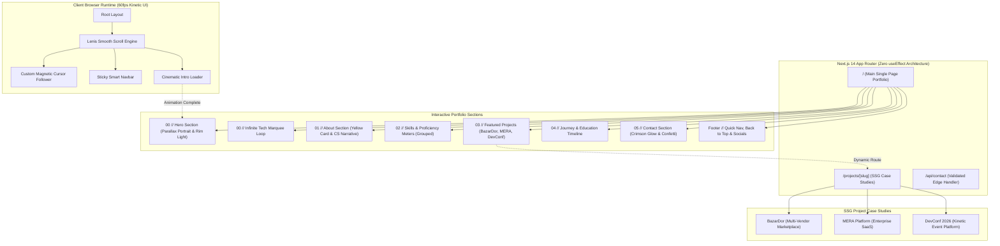

<div align="center">

# ⚡ AMIR HAMJA — PERSONAL PORTFOLIO
### *Production-Grade Kinetic Web Architecture & Interactive Case Studies*

[](https://nextjs.org/)
[](https://react.dev/)
[](https://www.typescriptlang.org/)
[](https://tailwindcss.com/)
[](https://www.framer.com/motion/)
[](https://vercel.com/)

<p align="center">
  <b>A single-page, dark-cinematic personal portfolio website crafted for Amir Hamja</b><br />
  <i>Full Stack Web Developer &amp; 3rd-Year Computer Science &amp; Engineering Student building toward his own startup.</i>
</p>

[🌐 Live Deployment](#-pre-deployment-checklist-for-vercel) • [📂 Project Structure](#-visual-system-architecture) • [🎨 Design Tokens](#-color-tokens--palette) • [🚀 Quick Start](#-quick-start--local-development)

---

</div>

## 🧭 Visual System Architecture



---

## 🎨 Color Tokens & Palette

Engineered specifically with warm glows so skin tones remain authentic and natural, complemented by electric lime and deep neon purple accents:

| Token | Hex Code | Visual Swatch | Role & Application |
| :--- | :--- | :--- | :--- |
| `--bg` | `#0B0B0D` |  | Obsidian background across all pages |
| `--surface` | `#141B2D` |  | Midnight navy card backgrounds and borders |
| `--text` | `#F2F2EE` |  | Warm ivory primary typography |
| `--muted` | `#9A9AA3` |  | Slate secondary text & descriptions |
| `--accent` | `#D7E52A` |  | **Electric Lime** (Primary brand accent & numbered labels) |
| `--purple` | `#8B5CF6` |  | **Neon Violet** (Ambient background aura & hover rings) |
| `--accent-2` | `#D81B52` |  | **Crimson** (Contact section aura & active status) |
| `--detail` | `#1F8A8A` |  | Deep teal micro-badges & metrics |

---

## 📸 Real Photo Treatment System

All portraits use authentic photography (no AI-generated faces or redraws), compressed to ultra-fast WebP format:

<table align="center">
  <tr>
    <td align="center" width="33%">
      <br />
      <b>HERO PORTRAIT</b><br />
      <sub>Dark charcoal blend into #0B0B0D, lime rim light, film grain &amp; parallax scroll.</sub>
    </td>
    <td align="center" width="33%">
      <br />
      <b>ABOUT CARD</b><br />
      <sub>Housed in a rounded lime-yellow card harmonizing with the warm yellow wall.</sub>
    </td>
    <td align="center" width="33%">
      <br />
      <b>CONTACT PORTRAIT</b><br />
      <sub>Soft crimson halo, grayscale-to-full-color transition on cursor hover.</sub>
    </td>
  </tr>
</table>

---

## ⚡ Core Sections & Feature Highlights

### `00` Loader & Hero Section
- **Cinematic Name Reveal**: Declarative Framer Motion progress reveal fading into the hero.
- **Hero Typography**: Large punchy headlines in Space Grotesk / Inter.
- **Magnetic Physics**: Interactive magnetic buttons pulling toward cursor coordinates on desktop.
- **Social Connectors**: Instant links to GitHub (`amirhamjaofc1`) and LinkedIn (`amir-hamja01`).

### `00` Infinite Tech Marquee
- Continuous smooth ticker showcasing: Next.js, React, TypeScript, Node.js, Tailwind, Better Auth, PostgreSQL, Prisma, Framer Motion, GSAP, MongoDB, Docker, Git, C++.
- Automatic pause on mouse hover.

### `01` About Amir Hamja
- Dual narrative: Academic computer science rigor paired with self-directed software velocity.
- Real-time stat counters: 3+ Years Building, 15+ Projects Shipped, 100% Startup Focus.
- Core philosophy cards: *Architectural Discipline*, *Kinetic Polish*, and *Startup Pragmatism*.

### `02` Grouped Technical Skills
- Interactive category tabs:
  1. **Frontend Architecture** (Next.js App Router, React 18, TypeScript, Tailwind, DaisyUI, HeroUI)
  2. **Backend & Systems** (Node.js, Better Auth, RESTful APIs, Server Actions, JWT, CSRF)
  3. **Database & Cloud** (PostgreSQL, MongoDB, Prisma ORM, Supabase, Vercel)
  4. **Core CS & Tools** (Data Structures, Algorithms, C/C++, Linux, Docker, Git)

### `03` Featured Project Case Studies
- **BazarDor**: Next.js 14, Better Auth (Google/GitHub OAuth), Tailwind, DaisyUI, HeroUI, Live: [bazar-dor-web-application.vercel.app](https://bazar-dor-web-application.vercel.app/)
- **MERA Platform**: Enterprise SaaS & multi-tenant operational analytics engine.
- **DevConf 2026**: Flagship developer conference portal with ticketing & schedule filters.
- **Dynamic SSG Case Studies** at `/projects/[slug]` with technical challenges, solutions, architecture breakdown, and future roadmaps.

### `04` Journey & Experience Timeline
- Chronological vertical timeline with glowing active nodes:
  - *Founder & Full Stack Product Builder (2024 - Present)*
  - *Independent Full Stack Web Developer (2023 - Present)*
  - *B.Sc. in Computer Science & Engineering (3rd Year)*
  - *Self-Directed Software Engineering Foundations (2021 - 2023)*

### `05` Contact & Direct Booking
- Direct channels: Email, WhatsApp, Phone, Location (Dhaka, BST / UTC+6).
- Validated form with real-time feedback, API route dispatch (`/api/contact`), and celebratory confetti particles.

---

## 💎 Modern Next.js Architecture (Zero `useEffect`)

This codebase follows modern React 18 & Next.js App Router standards by intentionally avoiding legacy `useEffect` anti-patterns:

- **Scroll Tracking**: Driven by Framer Motion's `useScroll` + `useMotionValueEvent`.
- **Smooth Scrolling**: Powered by `<ReactLenis>` from `lenis/react`.
- **Magnetic Buttons**: Declarative event coordinates using `useMotionValue` & `useSpring`.
- **Intro Animation**: Framer Motion `<motion.div>` with `onAnimationComplete`.
- **Cursor State**: Subscribed via React 18's official `useSyncExternalStore`.
- **Motion Accessibility**: Built-in `useReducedMotion()` from `framer-motion`.

---

## 📋 Pre-Deployment Checklist for Vercel

Before deploying to production on [Vercel](https://vercel.com/), check off the following items:

### 1. Personal Contact Details (`src/data/content.ts`)
Open [`src/data/content.ts`](./src/data/content.ts) and verify the `// TODO:` fields:
- [ ] **`email`**: Replace `'amirhamja.dev@gmail.com'` with your actual email address.
- [ ] **`phone`**: Replace with your phone number.
- [ ] **`whatsapp`**: Replace with your WhatsApp number.
- [ ] **`location`**: Verify `'Dhaka, Bangladesh'`.
- [ ] **`university`**: Update `'Computer Science & Engineering (3rd Year)'` with your university name (e.g. BRAC University, DIU, UIU).

### 2. Resume File (`public/resume.pdf`)
- [ ] Replace the placeholder PDF at [`public/resume.pdf`](./public/resume.pdf) with your real, up-to-date resume document (keep the filename `resume.pdf` so all download buttons point to it automatically).

### 3. Contact Form Email Integration (`src/app/api/contact/route.ts`)
- [ ] Out of the box, `/api/contact` validates inquiries and logs them to the server console.
- [ ] If you want inquiries sent directly to your email inbox, create a free account at [Resend](https://resend.com) or [Formspree](https://formspree.io) and add your API key in **Vercel Project Settings > Environment Variables**:
  ```bash
  RESEND_API_KEY=re_your_api_key_here
  ```

### 4. Custom Domain & Open Graph Metadata (`src/app/layout.tsx` & `sitemap.ts`)
- [ ] If you connect a custom domain (e.g. `amirhamja.dev` or `amirhamja.com`):
  - In [`src/app/layout.tsx`](./src/app/layout.tsx), update `metadataBase: new URL('https://yourdomain.com')`.
  - In [`src/app/sitemap.ts`](./src/app/sitemap.ts), update `baseUrl = 'https://yourdomain.com'`.

### 5. Verify Build & Push
- [ ] Run `npm run build` locally to ensure all static pages compile cleanly.
- [ ] Push changes to GitHub:
  ```bash
  git add .
  git commit -m "chore: finalize details for production deployment"
  git push origin main
  ```

---

## 🚀 Quick Start & Local Development

### Prerequisites
- **Node.js** >= 18.17.0 (Node 20+ recommended)
- **npm** or **pnpm** / **yarn**

### 1. Clone the repository
```bash
git clone https://github.com/amirhamjaofc1/portfolio.git
cd portfolio
```

### 2. Install dependencies
```bash
npm install
```

### 3. Run development server
```bash
npm run dev
```
Open **[http://localhost:3000](http://localhost:3000)** in your browser.

### 4. Build for production
```bash
npm run build
npm run start
```

---

## 🚢 Deploy to Vercel in 2 Minutes

1. Visit [vercel.com/new](https://vercel.com/new).
2. Connect your GitHub account and select the **`portfolio`** repository.
3. Keep default settings (Framework Preset: **Next.js**, Root Directory: `./`).
4. Click **Deploy**.
5. Vercel will build the project and assign a live production URL with automated SSL and edge caching!

---

<div align="center">

Designed &amp; Developed with precision by **Amir Hamja**  
*Full Stack Web Developer • CSE Undergraduate • Future Startup Founder*

[](https://github.com/amirhamjaofc1)
[](https://linkedin.com/in/amir-hamja01)

</div>
